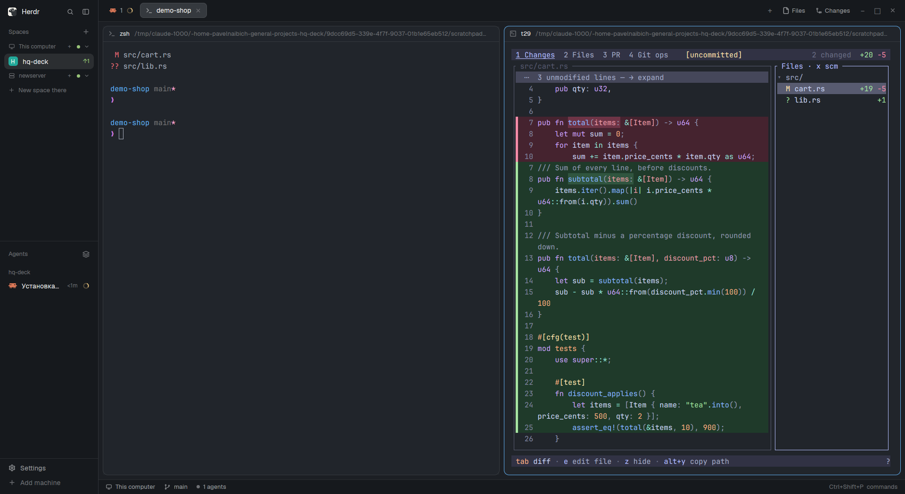

# hq-deck

One key opens [hq-deck](https://github.com/Snarap1/hq-deck), a review and source-control TUI, in a new pane to the right of the focused one.
It opens on the focused terminal's folder, so it reviews the worktree your agent is working in.
Comments you write in it go back to that agent with `s` (through `hc send`).

## What you see

Nothing until you press the key.
Then the focused pane splits in two: the original terminal stays on the left, and a new terminal running `hq-deck` takes the right half.
The new pane is an ordinary terminal pane with Herdr's usual header (`t<n>` and its folder); it splits, zooms and closes like any other.
The mod itself draws nothing: no panel, no sidebar entry, no popup you can see.

## How it behaves

- `super-y` (global) splits the focused pane to the right with `hq-deck` in it, in the focused terminal's folder.
- Each press opens another pane; it does not toggle or reuse an open one.
- Agent statuses (working, blocked, done, idle) are not shown by the mod.
  hq-deck itself picks the agent to send to: the live `hc` terminal that reports status and works in that worktree, preferring the one in its own tab, and never types into a blocked one.
- Closing the pane ends hq-deck; its comments are in memory only and leave with it.

## Built from

- `mods/hq-deck/mod.json`: `{"place": "none", "title": "hq-deck", "overlay": {"kind": "popup", "at": "top", "width": 1, "height": 1}}`.
  `place: none` keeps it out of every layout; the overlay is what `mod.open` opens.
- `mods/hq-deck/main.js`: a `View` whose `init` calls `run("pane.split", {direction: "right", argv: ["hq-deck"]})`, then `closeOverlay(props().overlay)` on the next tick; `render` returns an empty `div()`.
- `keys.json`: `{"global": {"super-y": "mod.open:hq-deck"}}`.
- Herdr functions: `run`, `closeOverlay`, `props`.
  Commands: `pane.split`, `mod.open`.
- Program it runs: `hq-deck` from `PATH` (installed with `cargo install`, usually `~/.cargo/bin`).
  It reads the repository with `git`, and `s` runs `hc ls` and `hc send`; the PR tab runs `gh` or `glab`.
  The mod itself reads no files and reaches no network.

## Watch out

- A key cannot do this on its own: the `name:value` shorthand fills only the first argument of `pane.split`, and the program goes in `argv`.
  That is the whole reason the mod exists.
- `hq-deck` must be on the `PATH` Herdr's core starts terminals with; if it is not, the pane opens and its program fails at once.
- The first `mod.open` right after copying the folder may do nothing while Herdr loads the new mod; press again.
- The window manager may take `super-y` first; rebind in `keys.json` if the key does nothing.
- Linux only, like hq-deck.

## Done when

- `herdr-app check mods/hq-deck` passes.
- With a terminal focused in a git repository, `super-y` adds one pane to its right running `hq-deck`, and `hc ls --json` shows one new terminal with that `cwd` and no `status`.
  `hc` does not name it after the program: its AGENT column reads `sh`.
- On a remote machine (a focused `machine/t<n>` terminal), the new pane opens on that machine and runs its own `hq-deck`, so it must be installed there; the herdr-app machine needs only the mod and the key.
- `herdr-app status` shows `"overlays": []` and `"errors": []` afterwards.
